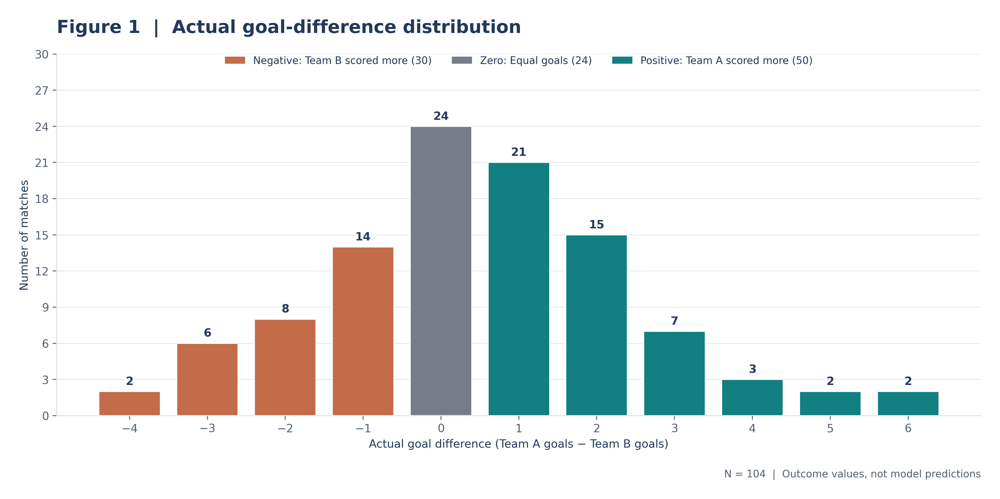
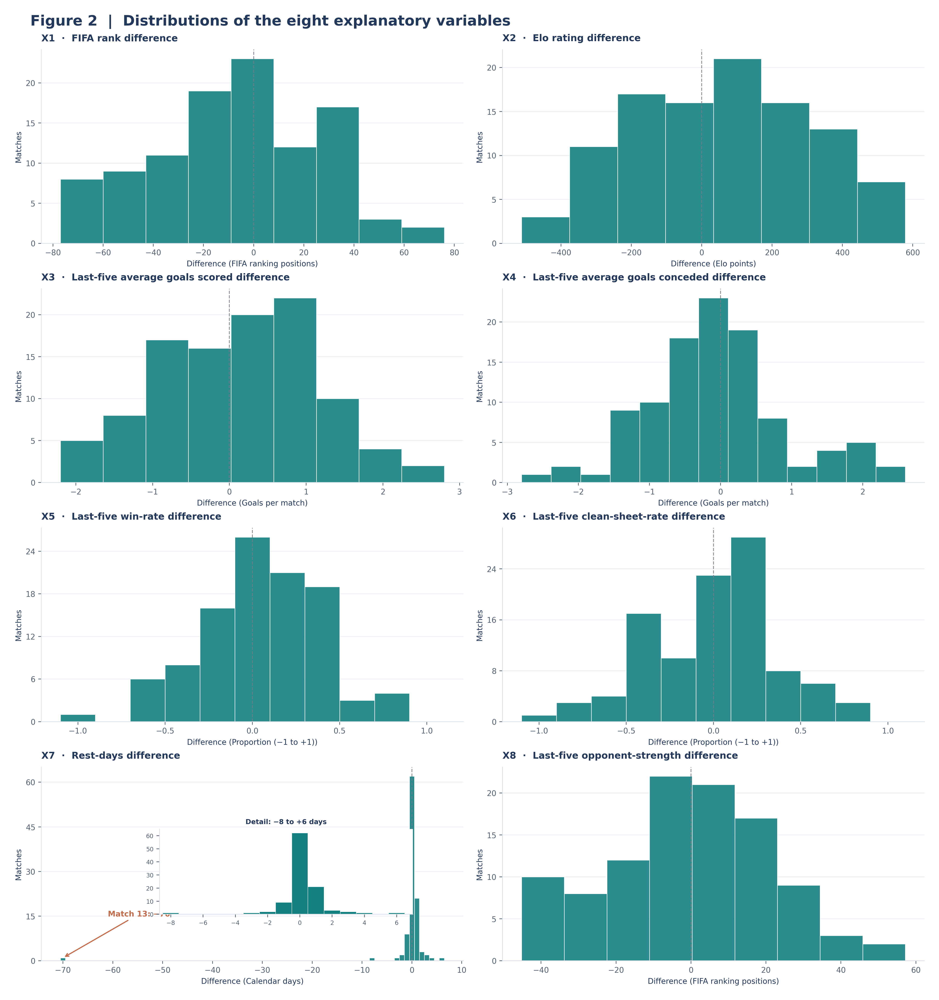
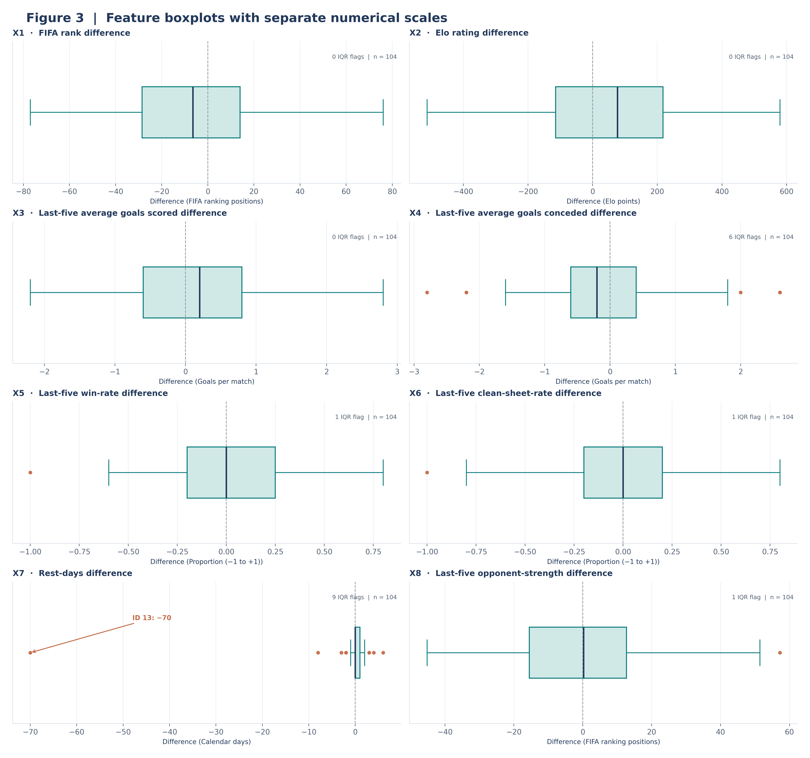
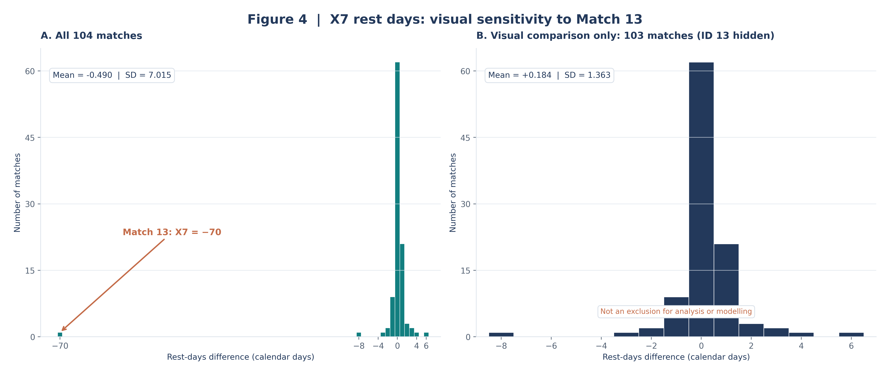
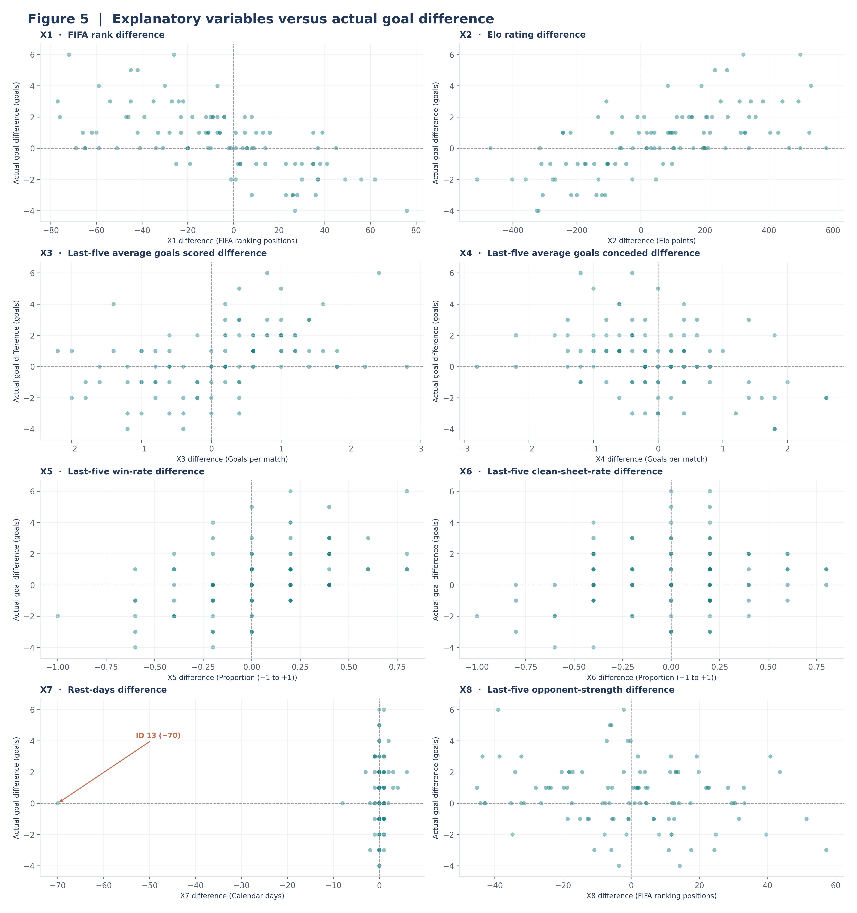

# FIFA World Cup 2026 — Multiple Linear Regression
## Member 1, Task 2: Exploratory Data Analysis and Visualisations

### Purpose and data provenance
This exploratory analysis describes the eight *pre-match* differences (X1–X8) and actual goal difference (Y) for the **104** fixtures in the supplied Excel worksheet `Master_104_Matches`. It is descriptive work for the written university report, not a regression model or test of statistical significance. Every figure is generated by `member1_task2_eda.py` directly from the original workbook. No external football records are consulted.

- Input sheet: `Master_104_Matches`; **104** records; nine numerical modelling columns complete; no records removed, modified, scaled, winsorised, or imputed.
- Predictor direction: each feature retains the input workbook's **Team A minus Team B** definition. For X1 (ranking difference) and X4 (goals conceded), lower values may have a different substantive interpretation from other feature differences.
- Target Y: Team A's actual match goals minus Team B's actual match goals, **not** an explanatory variable or model prediction.
- Source file SHA-256 (read-only input): `71da963689f5c79e08c4375114665b2388e72d219d58a2294a7afa6dda660d88`.
- Sample standard deviations use `ddof=1`; quartiles are pandas quantiles (25th and 75th percentiles); skewness is a descriptive pandas sample skewness coefficient.

### Figure 1 — Distribution of actual goal difference

**Suggested caption:** *Figure 1. Frequency of observed Team A minus Team B goal difference across all 104 World Cup matches. Negative, zero and positive outcomes are differentiated.*

The distribution includes **50 positive**, **30 negative** and **24 zero** goal differences. Positive means Team A scored more goals, negative means Team B scored more, and zero means equal goals in the recorded match score (a knockout tie can still be decided by penalties). Goal differences range from **-4** to **+6**, with median **0** and mean **+0.48** goals. The most common result is **0**, recorded in **24** matches. The individual difference frequencies are -4: 2, -3: 6, -2: 8, -1: 14, +0: 24, +1: 21, +2: 15, +3: 7, +4: 3, +5: 2, +6: 2. This plot describes the target spread; it does not establish whether a predictor will explain it.

### Figure 2 — Histograms of all eight explanatory variables

**Suggested caption:** *Figure 2. Eight separate histograms showing distributions of X1–X8. Each panel uses its own original unit and axis, with a vertical reference line at zero. X7 includes an inset showing its central range.*

The features have **different measurement units**, so a numerically larger range does not itself imply greater statistical importance. For example, X1 ranges from **-77 to 76 ranking places**, whereas X2 ranges from **-512 to 579 Elo points**. Their spreads should be interpreted within their own scales, not compared directly. X3 and X4 reflect goals-per-match differences; X5 and X6 are discrete proportion differences with medians **+0.00** and **+0.00**. X7 has median **+0** and is **strongly left-skewed** (skewness **-9.63**) largely because of Match 13. Apart from X7, all other feature skewness magnitudes are below 0.5 in the supplied data; that does not prove normality. X8 ranges from **-45.20** to **+57.20** FIFA-ranking places. Skewness is descriptive and, alone, cannot establish predictive usefulness.

### Figure 3 — Boxplots with independent feature scales

**Suggested caption:** *Figure 3. Individual horizontal boxplots for X1–X8 (N = 104 per panel). Boxes show Q1–Q3, the centre line shows the median, whiskers use the conventional 1.5 × IQR rule, and plotted points beyond whiskers indicate screening flags.*

Across the eight feature columns, the conventional **1.5 × IQR** rule flags **18 feature–match observations**, not necessarily 18 different matches and not confirmed errors. These comprise **6 X4**, **2 X5/X6**, **9 X7**, and **1 X8** flags; X1, X2 and X3 have no IQR flags. Match **13 (X7 = −70)** is the most pronounced rest-days observation. Match **18 (X8 = +57.20)** is also beyond X8's upper fence. A statistical flag requires a source or modelling review; it is not a reason to delete, cap or edit data automatically.

### Figure 4 — Focused X7 visual sensitivity comparison

**Suggested caption:** *Figure 4. X7 rest-days differences for (A) all 104 matches and (B) the remaining 103 after hiding Match 13 for visual sensitivity only. Panel B is not the analysis or modelling dataset; Match 13 remains retained in the original data.*

| X7 statistic | All 104 matches | Visual-only comparison (103 matches) |
|---|---:|---:|
| Mean (days) | -0.490 | +0.184 |
| Sample standard deviation (days) | 7.015 | 1.363 |
| Match 13 retained in calculation | Yes | No, panel only |

The extreme value of **−70** for Match 13 pulls the overall X7 mean below zero and makes its sample standard deviation much larger than it is in the 103-match view. The 103-match view reveals central rest-day intervals obscured by the full-range plot; it is *not* a recommendation to remove the observation. A high-leverage predictor value could affect later regression coefficients and diagnostics, depending on its relationship with the target and other features. Appropriate later checks include source verification, influence diagnostics and model sensitivity analysis using a principled analysis plan. **All 104 matches remain in this task.**

### Figure 5 — Each feature versus actual goal difference

**Suggested caption:** *Figure 5. Eight scatter plots of X1–X8 against recorded goal difference for 104 matches per panel, with transparent markers to reveal overlaps and zero-reference guides. No regression or trend lines are fitted.*

The y-values lie on **integer goal differences**, so repeated horizontal bands and some overplotting are expected, especially for discrete X5, X6 and X7 values near zero. The panels show a range of goal differences across both positive and negative feature values; Match 13 occupies an extreme negative X7 position but has **Y = +0**. This graphic can motivate questions about functional form, influential observations, and later predictor interrelationships, but it cannot establish statistical significance, independent predictive contribution, or causality. No correlations, regression fits, coefficients or prediction metrics were calculated.

### Descriptive statistical summary
The following statistics are from the source workbook. Units vary by column, so cross-variable numerical magnitudes are not directly comparable.

| Variable | N | Mean | Median | SD | Min | Q1 | Q3 | Max | Skewness |
|---|---:|---:|---:|---:|---:|---:|---:|---:|---:|
| X1 `fifa_rank_diff` | 104 | -7.21 | -6.50 | 33.64 | -77.00 | -28.50 | +14.00 | +76.00 | -0.07 |
| X2 `elo_rating_diff` | 104 | +59.95 | +76.50 | 246.46 | -512.00 | -114.50 | +217.50 | +579.00 | -0.04 |
| X3 `last5_avg_goals_scored_diff` | 104 | +0.13 | +0.20 | 1.02 | -2.20 | -0.60 | +0.80 | +2.80 | -0.06 |
| X4 `last5_avg_goals_conceded_diff` | 104 | -0.07 | -0.20 | 0.96 | -2.80 | -0.60 | +0.40 | +2.60 | +0.31 |
| X5 `last5_win_rate_diff` | 104 | +0.06 | +0.00 | 0.35 | -1.00 | -0.20 | +0.25 | +0.80 | -0.22 |
| X6 `last5_clean_sheet_rate_diff` | 104 | +0.00 | +0.00 | 0.37 | -1.00 | -0.20 | +0.20 | +0.80 | -0.23 |
| X7 `rest_days_diff` | 104 | -0.49 | +0.00 | 7.01 | -70.00 | +0.00 | +1.00 | +6.00 | -9.63 |
| X8 `last5_opponent_strength_diff` | 104 | -0.54 | +0.20 | 22.24 | -45.20 | -15.55 | +12.70 | +57.20 | +0.03 |
| Y `goal_difference` | 104 | +0.48 | +0.00 | 2.02 | -4.00 | -1.00 | +2.00 | +6.00 | +0.26 |

### Full IQR screening log — observations retained
For each feature, Q1 − 1.5 × IQR and Q3 + 1.5 × IQR define the screening fences. Flags are **not** assumed data errors.

| Match ID | Variable | Observed value | IQR lower | IQR upper |
|---:|---|---:|---:|---:|
| 9 | X7 `rest_days_diff` | +3.00 | -1.50 | +2.50 |
| 11 | X7 `rest_days_diff` | -8.00 | -1.50 | +2.50 |
| 13 | X7 `rest_days_diff` | -70.00 | -1.50 | +2.50 |
| 14 | X7 `rest_days_diff` | -2.00 | -1.50 | +2.50 |
| 18 | X7 `rest_days_diff` | -2.00 | -1.50 | +2.50 |
| 18 | X8 `last5_opponent_strength_diff` | +57.20 | -57.92 | +55.08 |
| 20 | X4 `last5_avg_goals_conceded_diff` | -2.20 | -2.10 | +1.90 |
| 20 | X7 `rest_days_diff` | +6.00 | -1.50 | +2.50 |
| 21 | X7 `rest_days_diff` | +4.00 | -1.50 | +2.50 |
| 22 | X7 `rest_days_diff` | -3.00 | -1.50 | +2.50 |
| 34 | X4 `last5_avg_goals_conceded_diff` | -2.80 | -2.10 | +1.90 |
| 44 | X4 `last5_avg_goals_conceded_diff` | +2.00 | -2.10 | +1.90 |
| 55 | X4 `last5_avg_goals_conceded_diff` | +2.60 | -2.10 | +1.90 |
| 57 | X4 `last5_avg_goals_conceded_diff` | -2.20 | -2.10 | +1.90 |
| 70 | X4 `last5_avg_goals_conceded_diff` | +2.60 | -2.10 | +1.90 |
| 70 | X5 `last5_win_rate_diff` | -1.00 | -0.88 | +0.93 |
| 70 | X6 `last5_clean_sheet_rate_diff` | -1.00 | -0.80 | +0.80 |
| 85 | X7 `rest_days_diff` | +3.00 | -1.50 | +2.50 |

### Implications, limitations and subsequent analysis
1. **Target shape:** The outcome spans -4 to +6 goals, with **24** recorded zero goal differences. Retain the full target distribution when later defining validation metrics.
2. **Different units:** X1/X8 use FIFA rank positions, X2 Elo points, X3/X4 goals per match, X5/X6 proportions, and X7 days. Descriptive magnitude alone does not rank their usefulness. No scaling is carried out here.
3. **Extreme X7:** Retain Match 13 and confirm provenance or physical plausibility before considering any later model diagnostics. The omission in Figure 4B is *visual only*.
4. **Evidence boundaries:** These analyses establish internal patterns of the provided workbook. They do not independently verify upstream historical fixture or ranking sources, nor do they test pre-kickoff availability of every input.
5. **No test-set-guided feature choice:** These full-data plots are for descriptive reporting. Once a train/test split is defined, choices learned from data, including imputation, scaling, feature selection and model tuning, should be fitted or chosen using training data only, rather than using held-out test data to drive decisions.
6. **Task boundaries:** No outliers removed; no transformations; no correlations/VIF; no train/test split; no EDA-based feature selection; no regression model, line, coefficients or predictions.

### Verification and reproducibility
- Worksheet loaded with pandas from the supplied workbook (read-only).
- Confirmed 104 rows, IDs 1–104 unique, nine modelling columns numeric/nonmissing, rate differences within [−1, 1], and `goal_difference = team_a_goals − team_b_goals` on every row.
- Verified target category frequencies 50 positive, 30 negative, 24 zero; X7 for Match 13 equals −70; and 18 IQR feature-level flags.
- Every histogram, boxplot and scatter panel is derived from exactly 104 original observations, except the *clearly labelled* Figure 4B with 103; the workbook itself remains untouched.
- Five PNG files are rendered at **320 DPI**. Figures use original data units, separate feature scales and descriptive annotations only.

### AI-assistance disclosure
Generative AI assisted in authoring the Python code, choosing the figure layout, and drafting descriptions and validation assertions. Numerical findings and images are calculated directly from the supplied workbook using pandas, NumPy and Matplotlib. Code-level checks verify consistency with that workbook; **they do not authenticate the football sources underlying the original data**. The work should be inspected and explained by the submitting student.
